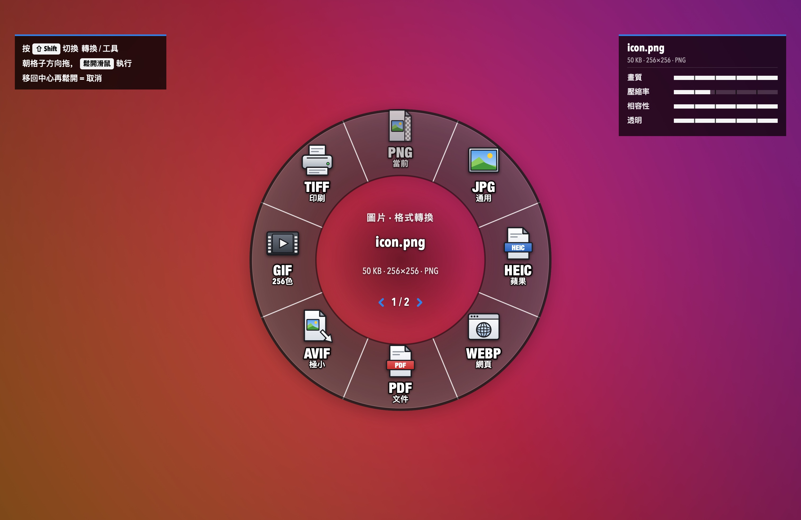
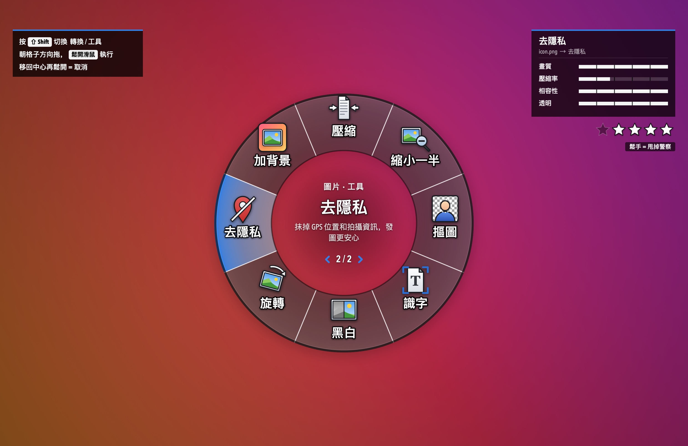
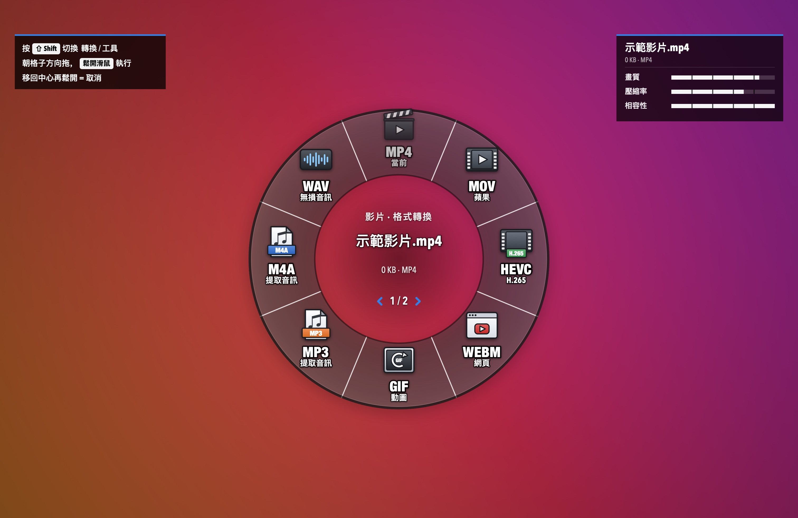
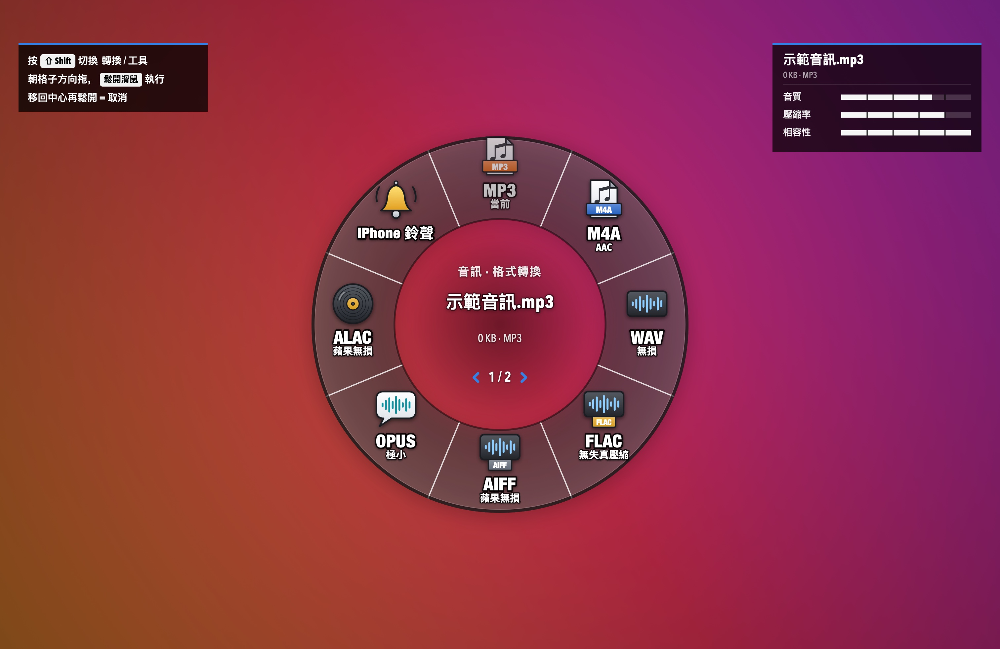
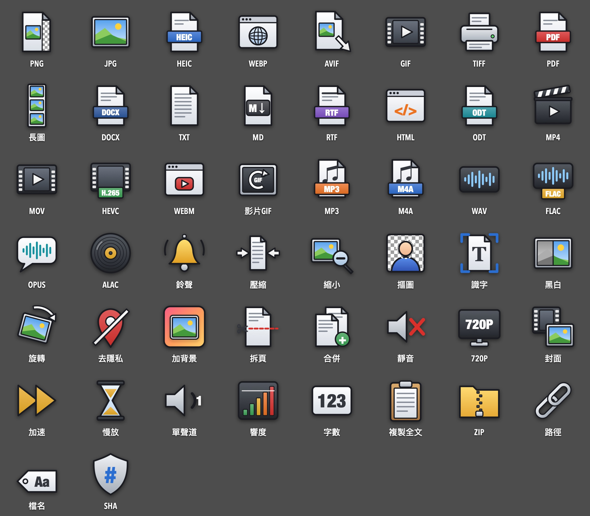
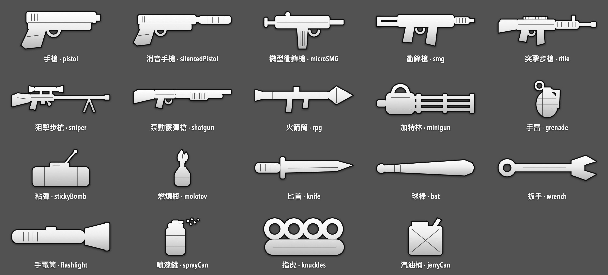
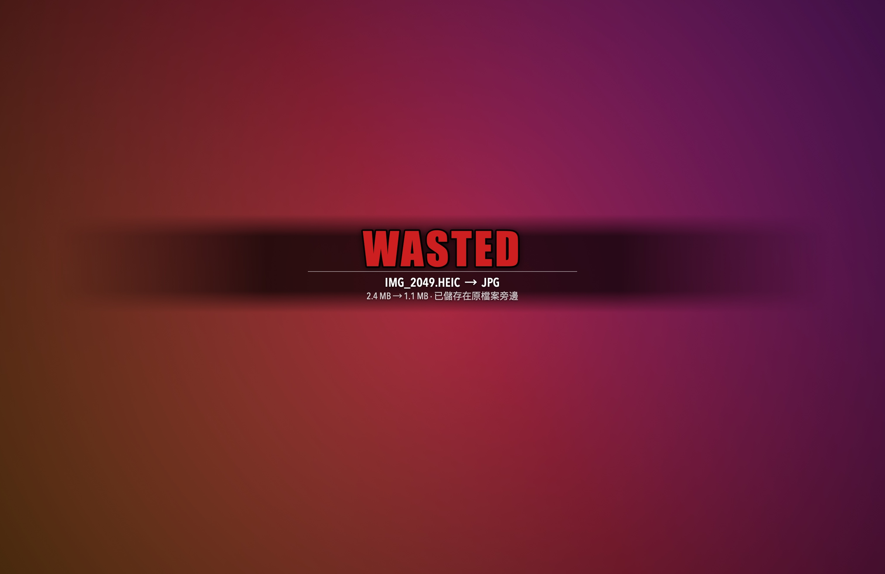

<p align="center">
  
</p>

<h1 align="center">格式輪盤 FormatWheel</h1>

<p align="center">
  <b>拖住檔案，按一下 ⇧ Shift，朝格子一甩，鬆手 —— 轉好了。</b><br>
  住在 macOS 選單欄裡的格式轉換輪盤：圖片、PDF、影片、音訊、文件，70 多種轉換和小工具，全程在本機完成。
</p>

<p align="center">
  <a href="https://github.com/HoXuanTech/FormatWheel/releases/latest/download/FormatWheel.dmg"></a>
  &nbsp;
  <a href="docs/media/wheel-image.jpg"></a>
</p>

<p align="center">macOS 14 及以上 · Apple 晶片 / Intel 通用 · 免費開源 · 不聯網</p>

<p align="center">
  
</p>

## 版本狀態

- **macOS 14 以上**：繁體中文介面 v1.1.0 已建置並驗證。
- **Windows 10 以上**：正在移植原版完整功能；目前尚無可供一般使用者安裝的正式版本。開發中的原始碼在 `windows/` 分支，不代表已通過 Windows 實機測試。

## 安裝

1. 下載 **[FormatWheel.dmg](https://github.com/HoXuanTech/FormatWheel/releases/latest/download/FormatWheel.dmg)**，雙擊開啟，把「FormatWheel」拖進「Applications」。
2. 如果 macOS 顯示「無法驗證開發者」，先確認檔案來自預期的發行頁並核對雜湊值。此版本未經 Apple 公證；是否信任與開啟，由使用者自行決定：
   - **macOS 14**：在「應用程式」裡**右鍵**點 FormatWheel →「開啟」→ 彈窗裡再點「開啟」。
   - **macOS 15 及以後**：先雙擊一次（會被攔下），然後開啟「系統設定 → 隱私與安全性」，拉到下面點「仍要開啟」，輸入開機密碼。
3. 開啟後選單欄會多一個小輪盤圖示（Dock 裡沒有），第一次會自動示範一遍。

想自己編譯？見[從原始碼構建](#從原始碼構建)。

## 怎麼用

1. 在 Finder 或桌面上**拖住**一個或多個檔案（先別鬆手），拖動中按一下 **⇧ Shift**：螢幕變暗，輪盤在滑鼠位置彈出。
2. 朝想要的格子**方向**移動滑鼠（方向對就行，不用拖到格子上），然後**鬆開滑鼠**。
3. 結果存在原檔案旁邊，原檔案不動。橫幅會寫明存到了哪；選單欄「最近轉換」裡點一下就能在 Finder 裡找到。

- 再按一次 Shift 翻到第 2 頁「工具」；移回中心再鬆開 = 取消。
- 不想拖放：選單欄圖示 →「選擇檔案開啟輪盤…」，直接點格子（Esc / Tab / 滾輪也能用）。
- 成功：先響一聲武器上膛，再彈 **MISSION PASSED**。失敗：螢幕壓暗 + **WASTED**，並告訴你怎麼修。

## 輪盤裡有什麼

| 檔案 | 第 1 頁 · 格式轉換 | 第 2 頁 · 工具 |
| --- | --- | --- |
| 圖片 | PNG · JPG · HEIC · WebP · PDF · AVIF · GIF · TIFF | 壓縮 · 縮小一半 · 摳圖 · 識字(OCR) · 黑白 · 旋轉 · 去隱私 · 加背景 |
| PDF | PNG · JPG · 長圖 · Word · TXT · Markdown · RTF · HTML | 壓縮 · 拆頁 · 合併 · 旋轉 · 黑白 · 識字 · 去隱私 · ZIP |
| 影片 | MP4 · MOV · HEVC · WebM · GIF · MP3 · M4A · WAV | 壓縮 · 靜音 · 720P · 截封面 · 2 倍速 · 慢放 · 去隱私 · ZIP |
| 音訊 | MP3 · M4A · WAV · FLAC · AIFF · Opus · ALAC · iPhone 鈴聲 | 壓縮 · 單聲道 · 響度統一 · 1.5 倍速 · ZIP · 複製路徑 |
| 文件 | PDF · Word · TXT · Markdown · HTML · RTF · ODT · DOC | 字數統計 · 複製全文 · 去隱私(Word) · ZIP · 複製路徑 |
| 其他 / 資料夾 | ZIP · 複製路徑 · 複製檔名 · SHA-256 | |

多選圖片時，PDF 格子會把它們合成一個 PDF。右上角屬性條：白色是保留的、藍色是提升、紅色是犧牲的。

<table>
  <tr>
    <td></td>
    <td></td>
  </tr>
  <tr>
    <td></td>
    <td></td>
  </tr>
</table>

## 通緝星級

輪盤開啟時，右上角會亮起通緝星：星越多，檔案裡能追蹤到你的資訊越多。

| 線索 | 星 |
| --- | --- |
| 照片 / 影片裡的 GPS 定位 | ★★ |
| 手機或相機型號、拍攝時間、機身序列號 | 各 ★ |
| PDF 的作者 / 製作軟體 / 主題關鍵詞 | ★★ / ★ / ★ |
| Word 文件的作者 / 修改人 / 公司名 | ★★ / ★ / ★ |

指向「去隱私」格子時星星開始閃；鬆手後星星閃爍消失 = 甩掉警察。照片、影片、PDF、Word 都支援，不重新壓縮畫面。

## 兩種格子圖示

預設是「格式圖示」：一眼看出格式本身的特點（PNG 帶透明格、JPG 風景照、WebP 瀏覽器、TIFF 印表機……），格式名下面一行小字寫著它的特點。選單欄 →「格子圖示」可以換成武器：PNG 突擊步槍、JPG 手槍、PDF 火箭筒、摳圖 匕首……

<table>
  <tr>
    <td></td>
    <td></td>
  </tr>
</table>

無論哪種圖示，轉換成功都會先響一聲對應的上膛聲：手槍拉套筒、步槍拉機柄、狙擊槍拉栓、霰彈槍“咔嚓”、重武器上彈、手雷拔環、匕首出鞘、近戰揮擊。

<table>
  <tr>
    <td></td>
    <td></td>
  </tr>
</table>

## 可選：裝上更多「彈藥」

WebP 需要 cwebp；AVIF、WebM、MP3、Opus、影片變速、音訊單聲道 / 響度統一 / 倍速需要 ffmpeg。沒裝時這些格子顯示「未裝備」，其他格子照常能用。裝了 [Homebrew](https://brew.sh) 的話一行搞定：

```bash
brew install ffmpeg webp
```

## 設定

都在選單欄圖示裡：最近轉換、格子圖示（格式 / 武器）、角色配色（線上模式 / 麥克 / 富蘭克林 / 崔佛）、輪盤大小、音效、背景虛化、完成橫幅、登入時自動啟動。

## 隱私

所有轉換都在你的 Mac 上完成：不聯網、不上傳、不收集任何資料。結果只寫在原檔案旁邊，日誌在 `~/Library/Logs/FormatWheel.log`。

## 從原始碼構建

只需要 Xcode Command Line Tools（`xcode-select --install`），不用裝 Xcode。

```bash
git clone https://github.com/HoXuanTech/FormatWheel.git
cd FormatWheel
./build.sh     # → build/FormatWheel.app（本機架構）
./package.sh   # → dist/FormatWheel.dmg 和 .zip（Apple 晶片 + Intel 通用）
```

命令列模式方便測試（`FormatWheel` 指 `build/FormatWheel.app/Contents/MacOS/FormatWheel`）：

- `FormatWheel --ids` 列出全部動作，`FormatWheel --run img.to.png 照片.heic` 執行一個
- `FormatWheel --scan 照片.jpg`：看檔案的通緝星級
- `FormatWheel --glyphs 圖鑑.png` / `--weapons 圖鑑.png`：匯出全部格式圖示 / 武器剪影
- `FormatWheel --sounds 資料夾`：匯出全部音效 WAV

宣傳片的畫面也是用 App 自己的繪圖程式碼逐幀渲染的（`./Promo/render.sh`，需要 ffmpeg），成片再剪輯配樂。

## 致謝

靈感來自 [@th2049 的這條推文](https://x.com/th2049/status/2111477585461039241)：拖檔案 + 按 Shift 就能轉格式。我們把它做成了一個輪盤。

本專案 fork 自 [Elise616/FormatWheel](https://github.com/Elise616/FormatWheel)，原版作者及 MIT 授權資訊保留於提交紀錄與 [LICENSE](LICENSE)。

## 許可

程式碼以 [MIT](LICENSE) 協議開源。`docs/media/promo.mp4` 僅作展示用途，其中背景音樂的版權歸原作者所有。

這是一個致敬向的個人作品，與任何遊戲公司無關：應用裡的圖示、武器剪影和音效全部由程式碼現畫、現合成，沒有使用任何遊戲素材。

---

**English** — FormatWheel is a macOS menu-bar app with a Traditional Chinese interface. Drag files, tap ⇧ Shift, flick toward a slot, and release to convert. [Download the DMG](https://github.com/HoXuanTech/FormatWheel/releases/latest/download/FormatWheel.dmg) (macOS 14+, Apple silicon & Intel). A full Windows 10+ port is in development and has no verified release yet.
